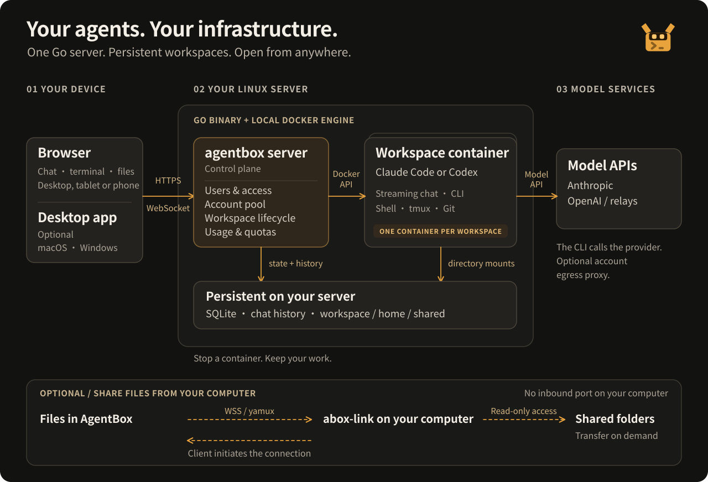

<div align="center">


# AgentBox

**Рабочая среда для разработки с AI-агентами на вашем сервере.**

Запускайте Claude Code и Codex CLI на своём Linux-сервере.<br /> От постановки задачи до проверки кода — чат, терминал, файлы и Git в одном окне браузера.

[](https://github.com/zyclonite135/agentbox/releases/latest) [](go.mod) [](images/agent/Dockerfile) [](LICENSE)

[English](README_EN.md) | [简体中文](README_CN.md) | **Русский**

[Демонстрация](#демонстрация) · [Возможности](#возможности) · [Скриншоты](#скриншоты) · [Быстрый старт](#быстрый-старт) · [Архитектура](#архитектура) · [Документация](#документация)

</div>

## Демонстрация

<a href="docs/media/agentbox-tour-en.mp4?raw=1"></a>

<p align="center"><a href="docs/media/agentbox-tour-en.mp4?raw=1"><strong>▶ Полная демонстрация в разрешении 1920 пикселей (MP4, 70 с)</strong></a> с предпросмотром файлов, статистикой использования и переключением между шестью стилями интерфейса · <a href="#скриншоты">Скриншоты</a></p>

<sub>Запись сделана в рабочем веб-интерфейсе на демонстрационных проектах. Диалоги, вывод команд и статистика подготовлены для записи. Ролик показывает работу интерфейса без запросов к моделям.</sub>

## Зачем нужен AgentBox

Настройте среду разработки на сервере один раз и возвращайтесь к проектам с ноутбука, настольного компьютера или телефона. На устройстве нужен только браузер. Агенты и инструменты проекта работают в Docker на сервере.

| Задача | Как помогает AgentBox |
| --- | --- |
| **Продолжить с того же места** | Файлы проекта, настройки домашнего каталога и история чата сохраняются между сеансами браузера |
| **Работать с привычными агентами** | Claude Code и Codex CLI доступны в веб-чате с потоковыми ответами и в собственных интерактивных терминалах |
| **Выполнить задачу в одном интерфейсе** | Загрузите файлы или клонируйте репозиторий, опишите задачу в чате, запустите проект, проверьте результат и изменения, затем создайте коммит, отправьте его или скачайте файлы |
| **Повторно использовать настройки** | Общие файлы пользователя, многоуровневые шаблоны домашнего каталога, навыки Claude и настройки MCP с переопределением для отдельных рабочих пространств |
| **Предоставить доступ доверенной команде** | Единый пул аккаунтов, права доступа по пользователям, статистика по каждому запросу, сохранённые тарифы и опциональная система кредитов |
| **Подключиться к своим сервисам** | Опциональный туннель abox-link к разрешённым репозиториям, базам данных и другим сервисам в частной сети |

Для работы нужен собственный сервер и подписка Claude или Codex, API-ключ либо аккаунт совместимого посредника. AgentBox предоставляет рабочую среду и инструменты управления. Запросы к моделям оплачиваются по условиям и тарифам вашего провайдера.

## Возможности

### Чат с возможностями CLI

- **Скачивание результатов.** Файлы, которые агент явно указал как результат, можно скачать прямо в чате. Для 1–4 файлов доступны отдельные кнопки. От 5 файлов чат показывает карточку со списком и ZIP, который сохраняет структуру папок. Ограничения ZIP — 512 файлов и 256 МиБ суммарного размера.
- **Изображения Codex.** Пока Codex генерирует изображение, веб-чат показывает карточку ожидания. Готовая картинка появляется прямо в чате. Нажмите на миниатюру, чтобы открыть оригинал. На телефоне путь, промпт и скачивание доступны в меню изображения, а длительность и стоимость — в подробностях ответа. Изображения видны и в истории, пока файлы остаются в рабочем пространстве.
- **Ход работы агента.** В потоке ответа видны краткие сводки рассуждений и вызовы инструментов. Вызовы Claude Code оформлены как в терминале. Например, `● Update(src/app.ts)` показывает изменения с номерами строк, операции чтения и запуска команд могут сворачиваться в «Прочитано 3 файла, выполнено 2 команды», а у субагентов отображаются собственные вызовы. Для команд Codex сохраняются названия из CLI (Read, Search, Shell, Edit), код завершения и длительность. Полный вывод и изменения можно открыть по нажатию. Над полем сообщения видны список задач агента (например, «Задачи 2/3 · Запуск тестов»), таймер текущего хода и круговой индикатор заполнения контекстного окна, как в строке состояния CLI.
- **Файлы через `@` и команды через `/`.** Введите `@`, чтобы найти файл по имени и вставить путь к нему. Символ `/` открывает список команд Claude Code, доступных в рабочем пространстве. Результат `/context` отображается цветной сеткой, как в CLI. Для аккаунтов с подпиской `/usage` показывает шкалы лимитов. Обе команды выполняются локально, без обращения к модели.
- **Уточнения и дополнительные сообщения.** Когда Claude задаёт вопрос во время работы, ответьте в карточке, и текущий ход продолжится. Можно писать сообщения, пока агент работает, чтобы поставить их в очередь на следующий ход или уточнить текущий. После ответа предлагаемое следующее сообщение отображается серым и подставляется клавишей Tab. Вопросы, уточнения на ходу и подсказки доступны в рабочих пространствах Claude.
- **Сохранение сообщений.** Черновики, копии текста на момент отправки и подтверждения для каждого сообщения сохраняются при обновлении страницы, обрыве связи и перезапуске сервера. Если результат неизвестен, интерфейс предложит проверить его перед повторной отправкой.

### Терминал CLI, файлы и Git

- **Терминал.** Запускайте оболочку, Claude Code или Codex в сеансе tmux, который сохраняется при переподключении. Несколько вкладок терминала позволяют одновременно запускать агентов над одними и теми же файлами. Поддерживаются сенсорная прокрутка, вставка долгим нажатием и копирование в буфер обмена.
- **Файлы.** Просматривайте, редактируйте, загружайте архивы и скачивайте файлы из проекта и каталога `/shared`. Для Markdown и HTML доступен предпросмотр.
- **Git.** Проверяйте изменения по файлам, создавайте коммиты, выполняйте `fetch` и `pull`, проверяйте список изменений перед отправкой и открывайте PR или MR. Поддерживаются токены HTTPS, SSH и OAuth GitHub или GitLab. Длительные сетевые операции выполняются в фоне.

### Работа в доверенной команде

- **Аккаунты.** Подписки, API-ключи и аккаунты посредников собраны в одном пуле. Для каждого пользователя задаётся доступ, а для каждого аккаунта — доступные модели и глубина рассуждений. Рабочее пространство можно переключить на другой аккаунт того же агента.
- **Расход и стоимость.** Для каждого запроса сохраняются токены, использование кеша, задержка, глубина рассуждений и тариф на момент расчёта. Вызовы из терминала тоже учитываются. Claude Code и Codex передают время до первого токена и длительность запроса в телеметрии. По этим данным можно получить задержку и скорость генерации в токенах в секунду. Для запросов без телеметрии показатели оцениваются по журналам CLI. Поддержание кеша помогает сохранить кеш длинного диалога Claude, пока вас нет, по умолчанию до трёх часов. Оно работает в чате и опционально в терминале, чтобы при возвращении не оплачивать повторную запись всего диалога в кеш. Доступны кредиты и экспорт в CSV.
- **Общие настройки.** Используйте навыки Claude, в том числе из официального каталога, многоуровневые шаблоны домашнего каталога и настройки серверов MCP по умолчанию с переопределением для отдельных рабочих пространств.
- **Частные сети.** Подключите abox-link для доступа к разрешённым сервисам в своей сети. Для каждого аккаунта можно задать отдельный исходящий прокси.
- **Объявления.** Администратор может показать уведомление на всех страницах и заранее посмотреть, чью работу затронет перезапуск. Объявление об обновлении показывает отсчёт до запуска и подтверждает завершение после старта новой версии. [Подробнее об объявлениях](docs/announcements.md)

### Расширения, делегирование и оформление

- **Расширения.** Администратор включает их по отдельности. Loop guard прерывает повторяющийся ответ при работе через API-ключи и аккаунты посредников. Webhook-уведомления отправляют события рабочего пространства и хода агента в Feishu, DingTalk, WeCom или на любой адрес, принимающий JSON. [Архитектура расширений](docs/architecture/extensions-spi.md)
- **Делегирование задач (предварительная версия).** Основной агент на более мощной модели передаёт чётко сформулированные подзадачи более дешёвым моделям в том же рабочем пространстве. [Архитектура делегирования](docs/architecture/delegation-supervisor.md)
- **Стили и языки.** Шесть встроенных стилей в светлом и тёмном вариантах, редактор пользовательских тем с предпросмотром, упрощённый и традиционный китайский, английский и русский языки, а также адаптация для телефонов. [Темы оформления](docs/themes.md)

Все возможности чата и требования к версии Claude Code в образе агента описаны в руководстве на китайском языке. [Руководство по рабочим пространствам](docs/user-guide.md#对话)

## Скриншоты

Скриншоты сохранены в PNG с удвоенным разрешением. Нажмите на изображение, чтобы открыть его в полном размере.

<a href="docs/images/en/chat-dark.png"><picture><source media="(prefers-color-scheme: light)" srcset="docs/images/en/chat-light.png" /></picture></a>

<table>
<tr>
<td width="50%" valign="top"><a href="docs/images/en/chat-live.png"></a><br /><strong>Ход в процессе</strong><br /><sub>Вызовы инструментов в реальном времени, задачи агента, таймер и индикатор контекста.</sub></td>
<td width="50%" valign="top"><a href="docs/images/en/chat-context.png"></a><br /><strong><code>/context</code> без запроса к модели</strong><br /><sub>Команды берутся из Claude Code в рабочем пространстве. Использование контекста показано как в терминале.</sub></td>
</tr>
<tr>
<td valign="top"><a href="docs/images/en/terminal.png"></a><br /><strong>Терминал</strong><br /><sub>Сохраняемый сеанс tmux для оболочки или CLI агента.</sub></td>
<td valign="top"><a href="docs/images/en/changes.png"></a><br /><strong>Проверка изменений</strong><br /><sub>Сравнение по файлам перед коммитом, отправкой или открытием PR или MR.</sub></td>
</tr>
<tr>
<td valign="top"><a href="docs/images/en/files.png"></a><br /><strong>Файлы</strong><br /><sub>Редактирование, загрузка и скачивание файлов проекта и общих каталогов.</sub></td>
<td valign="top"><a href="docs/images/en/preview.png"></a><br /><strong>Предпросмотр документов</strong><br /><sub>Переключение между исходным текстом и отображением Markdown или HTML.</sub></td>
</tr>
<tr>
<td valign="top"><a href="docs/images/en/usage.png"></a><br /><strong>Расход по каждому запросу</strong><br /><sub>Фильтры, итоги, доля попаданий в кеш, глубина рассуждений, задержка и экспорт в CSV.</sub></td>
<td valign="top"><a href="docs/images/en/accounts.png"></a><br /><strong>Аккаунты</strong><br /><sub>Подписки, API-ключи и посредники с настройками доступа и моделей.</sub></td>
</tr>
<tr>
<td valign="top"><a href="docs/images/en/skills.png"></a><br /><strong>Навыки</strong><br /><sub>Установка в рабочее пространство или шаблон пользователя и просмотр файлов навыка.</sub></td>
<td valign="top"><a href="docs/images/en/mcp.png"></a><br /><strong>Серверы MCP</strong><br /><sub>Настройки по умолчанию, переопределение в рабочих пространствах, импорт JSON и проверка подключения.</sub></td>
</tr>
<tr>
<td valign="top"><a href="docs/images/en/extensions.png"></a><br /><strong>Расширения</strong><br /><sub>Подтверждение разрешений и выбор аккаунтов или пользователей, для которых действует расширение.</sub></td>
<td valign="top"><a href="docs/images/en/tunnel.png"></a><br /><strong>Туннель в частную сеть</strong><br /><sub>Состояние abox-link, список разрешённых адресов и загрузка клиентов.</sub></td>
</tr>
</table>

<a href="docs/images/en/styles.png"></a>

<p align="center"><sub>Шесть встроенных стилей со светлыми и тёмными вариантами. На их основе можно создавать собственные темы.</sub></p>

<p align="center"><a href="docs/images/en/chat-mobile.png"></a><br /><sub>То же рабочее пространство на телефоне.</sub></p>

## Быстрый старт

### Установка на Linux-сервере

```bash
curl -fsSL https://raw.githubusercontent.com/zyclonite135/agentbox/refs/heads/feature/my-change/install.sh | sudo bash -s -- --lang ru
```

Установщик скачивает и проверяет серверный пакет, собирает образ рабочего пространства и запускает `agentbox.service`. **Устанавливать Go и Node.js на сервер не требуется.** Первая сборка образа занимает несколько минут. Для неё нужен доступ к реестрам контейнеров, репозиториям Debian и npm.

Флаг `--lang ru` включает русский вывод установщика. По умолчанию используется английский. В старых пакетах, включая `v0.1.21`, итоговые сообщения по-прежнему выводятся на китайском.

- **Требования к серверу.** Linux x86_64 или arm64, systemd и локальный Docker Engine. На Ubuntu 22.04+ и Debian 12+ установщик добавит недостающие зависимости и при отсутствии Docker установит Docker CE из официального репозитория. Для новой установки Docker установщик создаёт `/etc/docker/daemon.json` с драйвером журналов `local`, если файла ещё нет. [Требования для других дистрибутивов](deploy/README.md#一键安装)
- **Первый вход.** Откройте `http://IP_СЕРВЕРА:8180`, выберите **Русский** и войдите как `boxadmin` с паролем, который установщик сгенерировал и вывел в терминале. Если подключаетесь напрямую, откройте TCP-порт 8180 в межсетевом экране. Для постоянного публичного доступа настройте HTTPS. [Настройка HTTPS](deploy/README.md#https-与-websocket-反向代理)
- **Стабильная версия сервера.** Установщик выбирает последний стабильный релиз форка. Чтобы принимать соединения только с самого сервера, добавьте `--listen 127.0.0.1:8180` в конец команды. [Релизы форка](https://github.com/zyclonite135/agentbox/releases)
- **Уже установленный сервер.** Обновите его в разделе **О программе и обновления** или по инструкции для текущей установки. Установщик сохраняет существующее развёртывание. [Руководство по обновлению](docs/releases.md#升级与回退)

Конфигурация хранится в `/etc/agentbox`, данные — в `/var/lib/agentbox`. По умолчанию каждому рабочему пространству выделяется до 2 ГиБ памяти и 2 процессорных ядер. Учитывайте количество одновременно работающих пространств при выборе сервера. [Установка и восстановление](deploy/README.md#一键安装)

Если вы пропустили начальный пароль, прочитайте его из поля `auth_token` на сервере со стандартной установкой.

```bash
sudo python3 -c 'import json; print(json.load(open("/etc/agentbox/config.json"))["auth_token"])'
```

Если вы сменили начальный пароль и забыли новый, его можно сбросить. [Восстановление доступа администратора](docs/troubleshooting.md#忘记密码或改了-auth_token-仍不能登录)

### Обновления сервера в этом форке

Установщик и раздел **О программе и обновления** проверяют стабильные релизы GitHub из репозитория `zyclonite135/agentbox`. На штатной установке Linux/systemd кнопка **Обновить и перезапустить** становится доступна, когда в форке появляется более новый стабильный релиз.

Чтобы подготовить релиз, соберите пакеты из проверенной копии репозитория без локальных изменений командой `python3 scripts/build-release.py --version vX.Y.Z --output output/fork-release`. Проверьте их командой `python3 scripts/test-release.py output/fork-release`. Прикрепите соответствующие архивы Linux, `SHA256SUMS` и `release.json` к стабильному релизу GitHub для этого коммита. Каждая установленная версия включает обновлятор форка.

Для локальной проверки в Docker пересоберите серверный образ из исходников форка и пересоздайте контейнер с прежним томом данных. Для ручного обновления Linux используйте пакет и контрольную сумму из релизов форка. [Ручное обновление](deploy/downloads/README.md#手工安装与升级)

### Первая задача

При первом входе администратор увидит подсказки по проверке окружения, подключению аккаунтов и выбору моделей по умолчанию. Остальные пользователи увидят аккаунты, к которым у них есть доступ.

1. **Добавьте аккаунт** в разделе **Настройки → Аккаунты**. Выберите Claude или Codex и подключите подписку, API-ключ или аккаунт посредника. Запросите список моделей у провайдера, оставьте те, к которым у аккаунта есть доступ, и настройте глубину рассуждений для каждой. Если посредник не возвращает список, воспользуйтесь официальным каталогом, который поставляется вместе с CLI в образе агента. [Настройка аккаунтов](docs/accounts-and-models.md)
2. **Создайте рабочее пространство** с пустым проектом, из загруженного архива или из Git-репозитория. Выберите агента и аккаунт. Позже можно переключиться на другой аккаунт того же агента через меню `⋯` рабочего пространства. [Импорт проекта](docs/project-creation.md)
3. **Опишите задачу в чате.** Ссылайтесь на файлы через `@`, выполняйте команды в терминале и открывайте файлы для проверки результата. Все три раздела работают с одними и теми же файлами проекта.
4. **Проверьте изменения** перед коммитом. Скачайте результат или настройте подключение к Git, чтобы отправить изменения и открыть PR или MR. [Руководство по рабочим пространствам](docs/user-guide.md)

<details>
<summary><strong>Сборка из исходников</strong></summary>

Для сборки нужен Linux с Docker, Git и инструментами Go той версии, которая указана в [go.mod](go.mod).

```bash
git clone --branch feature/my-change https://github.com/zyclonite135/agentbox.git
cd agentbox
go build -o agentbox ./cmd/agentbox
./scripts/build-image.sh
openssl rand -hex 24
```

Сохраните конфигурацию в `config.json`, подставив сгенерированное значение вместо `CHANGE_ME_TO_A_LONG_RANDOM_TOKEN`.

```json
{
  "listen": "127.0.0.1:8180",
  "auth_token": "CHANGE_ME_TO_A_LONG_RANDOM_TOKEN",
  "data_dir": "data",
  "agent_image": "agentbox-agent:latest",
  "accounts": [],
  "proxies": []
}
```

```bash
sudo ./agentbox -config config.json
```

Откройте `http://127.0.0.1:8180` на сервере. Для доступа со своего компьютера выполните `ssh -N -L 8180:127.0.0.1:8180 user@your-server` и откройте тот же адрес в локальном браузере. Войдите как `boxadmin` со значением `auth_token` из конфигурации. При первом запуске пароль сохраняется в базе данных. В дальнейшем пароль меняется через настройки или процедуру сброса. Если вы забыли пароль, остановите службу и выполните `agentbox admin-reset-password --config /path/to/config.json --user boxadmin`. [Порядок восстановления](docs/troubleshooting.md#忘记密码或改了-auth_token-仍不能登录)

Серверу нужен доступ к Docker и право устанавливать владельца и группу подключаемых каталогов в `1000:1000`. Чтобы установить сборку как службу systemd, остановите запущенный вручную экземпляр, затем выполните `sudo ./deploy/install.sh` и `sudo ./deploy/deploy.sh`. [Развёртывание](deploy/README.md) · [Конфигурация](docs/configuration.md) · [Разработка](docs/development.md)

</details>

## Архитектура

**Один сервер на Go, SQLite и Docker.** Веб-интерфейс встроен в серверный бинарный файл. Каждому рабочему пространству соответствует отдельный контейнер, а файлы и история сохраняются на сервере.

[](docs/images/architecture.svg)

| Компонент | Назначение |
| --- | --- |
| **Браузер или приложение для ПК** | Подключение к серверу и работа с рабочими пространствами |
| **Сервер AgentBox** | Аутентификация, доступ к аккаунтам, жизненный цикл рабочих пространств, HTTP и WebSocket, операции Git, учёт расхода и кредитов, расширения |
| **Контейнеры рабочих пространств** | Запуск Claude Code, Codex CLI и инструментов проекта, подключение к настроенному провайдеру моделей |
| **Постоянное хранилище** | Состояние и расчёты в SQLite, файлы проектов, домашние и общие каталоги, история чатов в JSONL |
| **Опциональный abox-link** | Подключение к частным сервисам, доступным с вашего компьютера и явно внесённым в список разрешённых |

Чат и терминал работают с общими файлами. Каждый ведёт свой контекст диалога. В рабочем пространстве можно вести несколько чатов. По умолчанию до трёх чатов могут одновременно выполнять запросы. Администратор может изменить этот лимит. Если в чате уже выполняется запрос или достигнут лимит, новые сообщения встают в очередь. Длинные чаты открываются на последних сообщениях, а предыдущие подгружаются при прокрутке вверх. Каталог `/shared` доступен во всех рабочих пространствах пользователя. При остановке контейнера его процессы завершаются, а файлы и история сохраняются.

## Способы подключения

| Способ | Для чего подходит | Доступность |
| --- | --- | --- |
| **Веб-интерфейс** | Чат, терминал CLI, файлы, Git, навыки, MCP и администрирование | Встроен в сервер. Для работы достаточно браузера |
| **Приложение для ПК** | Доступ с Windows и macOS, терминалы проектов, передача файлов и опциональная синхронизация | Публичная тестовая версия без цифровой подписи. [Скачать 0.1.2](https://github.com/devilcoolyue/agentbox/releases/tag/desktop-v0.1.2) |
| **abox-link** | Доступ из облачных рабочих пространств к разрешённым адресам в частной сети | Опциональная локальная панель или командная строка без интерфейса для Windows, macOS и Linux |
| **API HTTP и WebSocket** | Автоматизация операций с рабочими пространствами и запросов статистики | [Справочник API](docs/api.md) |

Приложение для ПК подключается к существующему серверу, который устанавливается и обновляется отдельно. **Синхронизация по умолчанию отключена, включить её может администратор.** Версию 0.1.2 нужно скачивать и обновлять вручную. Сборка macOS распространяется без нотаризации Apple, а сборка Windows — без цифровой подписи. Поддержка нескольких языков появилась в исходном коде после выпуска 0.1.2. [Руководство по приложению для ПК](desktop/README.md)

Опциональные возможности сервера включают удалённый браузер с сохранением входа на сайты, общую установку Go SDK и браузеров в режиме чтения с отдельным кешем для каждого пользователя, квоты на файлы проектов и очистку кеша. При обновлении образа агента новый образ собирается на зафиксированной базе и проверяется перед переключением. [Удалённый браузер](docs/remote-browser.md) · [Общие инструменты](docs/shared-tools.md) · [Управление хранилищем](docs/storage-capacity.md) · [Проверка образов](docs/agent-image-validation.md)

## Условия эксплуатации

- **Подключайте доверенных пользователей и аккаунты.** CLI получает учётные данные внутри контейнеров. Пользователи с доступом к терминалу могут их прочитать. Права доступа определяют, кто может начать работу с аккаунтом. После отзыва доступа уже выданные учётные данные и запущенные процессы сохраняются. [Права доступа к аккаунтам](docs/accounts-and-models.md#账号使用范围)
- **Храните файлы в постоянных каталогах.** Для этого подходят `/workspace`, `/home/agent` и `/shared`. Остановка, пересборка или приостановка по тайм-ауту завершают процессы контейнера. После закрытия браузера контейнер продолжает работу до остановки по обычным правилам.
- **Учитывайте расходы сверх баланса кредитов.** В веб-чате расход начисляется по завершении каждого запроса к модели, а баланс проверяется лишь перед началом хода. Последний допущенный ход может превысить доступный остаток. Расход в терминале учитывается без списания кредитов. [Расход и квоты](docs/usage-and-quotas.md)
- **Делайте полную резервную копию для файлов пользователей.** Системная копия включает конфигурацию, учётные данные, состояние базы, шаблоны и настройки MCP. Для сохранения файлов рабочих пространств и истории чатов остановите службу и соответствующие контейнеры и сделайте полную копию. [Резервное копирование и восстановление](deploy/README.md#备份与恢复)
- **Развёртывайте AgentBox в доверенной среде.** Сервер обращается к локальному Docker и использует один процесс на каталог данных. По умолчанию агенты выполняют код с `bypassPermissions`. Контейнеры запускаются от непривилегированного пользователя с лимитами ресурсов. При развёртывании клиенты ненадолго теряют соединение.
- **Проверяйте и отправляйте изменения отдельными действиями.** В веб-интерфейсе коммит записывается локально и отправляется отдельной командой. Используйте терминал для коммитов с хуками или подписью. [Управление Git](docs/architecture/git-management.md)

## Документация

README на английском, китайском и русском охватывают возможности проекта и настройку. Подробные руководства написаны на китайском. [Оглавление документации](docs/README.md)

| Задача | Документация |
| --- | --- |
| Использовать чат, терминал, файлы, предпросмотр и Git | [Руководство по рабочим пространствам](docs/user-guide.md) |
| Подключить аккаунты или выбрать модели | [Аккаунты и модели](docs/accounts-and-models.md) |
| Повторно использовать навыки, шаблоны и инструменты MCP | [Навыки, плагины и MCP](docs/skills-and-mcp.md) |
| Понять и контролировать расходы | [Расход и кредиты](docs/usage-and-quotas.md) · [Каталоги тарифов](docs/pricing-catalog.md) |
| Включить расширения или остановить повторяющиеся ответы модели | [Расширения и SPI](docs/architecture/extensions-spi.md) · [Отдельный Loop guard (предварительная версия)](docs/loop-guard.md) |
| Делегировать подзадачи более дешёвым моделям | [Делегирование задач](docs/architecture/delegation-supervisor.md) |
| Подключиться к частным сервисам | [Прокси и abox-link](docs/networking.md) |
| Установить, обновить, создать резервную копию или восстановить сервер | [Развёртывание](deploy/README.md) · [Релизы](docs/releases.md) · [Совместимость CLI](docs/compatibility.md) |
| Настроить сервер или интегрировать его с другим сервисом | [Конфигурация](docs/configuration.md) · [Справочник API](docs/api.md) |
| Выбрать язык или создать тему | [Языки](docs/i18n.md) · [Темы оформления](docs/themes.md) |
| Устранить ошибку | [Устранение неполадок](docs/troubleshooting.md) · [Коды ошибок](docs/errors.md) · [Диагностика](docs/diagnostics.md) |
| Узнать, что изменилось | [История изменений](CHANGELOG.md) · [Возможности и проверки](docs/capabilities.md) |
| Внести вклад в проект | [Руководство по разработке](docs/development.md) · [Правила участия](CONTRIBUTING.md) |

## План развития

Серверная версия **v0.1.20** вышла в оригинальном проекте 12 ноября 2026 года. Ниже перечислены изменения в ней и предыдущих выпусках. [История изменений](CHANGELOG.md)

- **v0.1.13** — делегирование подзадач, редактор тем и управление локальным хранилищем.
- **v0.1.14** — вопросы и дополнительные сообщения в чате, команды `/`, ссылки на файлы через `@`, индикатор контекста, список задач и расчёт стоимости по запросам.
- **v0.1.16** — расширения, Webhook-уведомления, таймер хода и фоновые сетевые операции Git.
- **v0.1.17** — поддержание кеша промпта, измерение задержки и расчёт стоимости в реальном времени по запросам, вызовы инструментов в стиле CLI и управление значками.
- **v0.1.18** — навигация по диалогу, системные объявления с отсчётом до обновления, ограничение исходящего трафика рабочих пространств, учёт расхода в терминале и лимиты хранилища по пользователям.
- **v0.1.19** — до трёх параллельных чатов в одном пространстве, вкладки терминала и сворачиваемая верхняя панель.
- **v0.1.20** — `abox-remote` для выполнения задач на своём компьютере через туннель, панель входов и последней активности для администратора, график расхода и настройка количества одновременных чатов.

Первый этап (M1–M5) охватывал диагностику, первый запуск, надёжность чата, обслуживание и согласованность приложения для ПК с веб-версией. Его результаты вошли в v0.1.11. В плане внешней проверки остаются наблюдения за работой реальных пользователей, пороги производительности, требования к восстановлению и подпись приложения для ПК. [Итоги первого этапа](docs/milestones/backlog.md)

| Этап | План работ |
| --- | --- |
| **M6 · Подготовка и выпуск стабильной версии** | Зафиксировать изменения разработки, прогнать CI целиком, выпустить v0.1.11 и сверить сведения о версиях в документации. [Отчёт](docs/milestones/m6.md) |
| **M7 · Проверка на реальных задачах и базовые метрики** | Собирать агрегированные метрики на экземпляре с обезличенным экспортом, наблюдать за реальными задачами, согласовать показатели производительности и восстановления |
| **M8 · Удобство ежедневной работы** | Устранить частые проблемы, выявленные при наблюдениях. В числе кандидатов архивация пространств, уведомления о завершении задач и отображение длинных диалогов |
| **M9 · Обновления зависимостей и упрощение установки** | Готовые образы агента, повышение базовых версий CLI, регулярные обновления зависимостей и расширение генерации контрактов |
| **M10 · Стабильный выпуск приложения для ПК** | Подпись и нотариальное заверение, проверка минимальных версий ОС и реальных устройств, пилотное тестирование синхронизации. При недоступности сертификатов предусмотрен тестовый выпуск |
| **M11 · Дополнительные агенты** | Реестр провайдеров, транспорт ACP и опциональные агенты в образе. Первым планируется Kimi Code CLI |

На каждую итерацию ориентировочно отводится **три недели**. Порядок и объём работ зависят от обратной связи и результатов проверок. В планах на китайском языке описаны объём работ, зависимости и критерии приёмки. Предложения с конкретными сценариями можно оставлять в Issues. [План второго этапа](docs/roadmap-2.md) · [Архивный план первого этапа](docs/roadmap.md)

## Сборка и участие в разработке

Список возможностей и проверок показывает, что реализовано, в каких версиях выпущено и что ещё предстоит проверить. Выполните `python3 scripts/verify.py list`, чтобы выбрать проверки, или `python3 scripts/verify.py run quick`, чтобы провести быстрые локальные проверки с сохранением отчётов. [Список возможностей и проверок](docs/capabilities.md) · [Руководство по проверкам](docs/verification.md)

Сервер использует **Go, SQLite и Docker**. Веб-интерфейс использует **TypeScript, стандартные модули ES и xterm.js**. [Инструменты и проверки для разных платформ](docs/development.md)

```bash
go build ./...
go test ./...

# Если меняете веб-интерфейс
npm ci
npm run check
npm run build
```

Включайте в коммит с изменениями `web/src/` сгенерированные файлы из `internal/web/static/js/`. Полная проверка контейнеров выполняется на Linux, а на macOS доступны сборка и модульные тесты. Скриншоты и демонстрацию выше можно обновить из выпущенной версии интерфейса скриптами `scripts/capture-readme.mjs` и `scripts/render-readme-tour.mjs`. [Руководство по съёмке](docs/development.md#文档截图)

Приветствуются отчёты об ошибках, предложения по рабочим сценариям и небольшие pull request. В отчёте укажите шаги воспроизведения и приложите журналы без конфиденциальных данных. Об уязвимостях сообщайте приватно. Если AgentBox пригодился вам, поставьте звезду репозиторию, чтобы другие разработчики могли его найти. [Как сообщить об уязвимости](SECURITY.md)

## Лицензия и сообщество

[Apache-2.0](LICENSE) · [Уведомления об авторских правах](NOTICE) · [Лицензии сторонних компонентов](third_party/README.md) · [История изменений](CHANGELOG.md)

На сервисы моделей и используемые CLI распространяются условия их поставщиков. Спасибо сообществу за поддержку и обсуждения. [LINUX DO](https://linux.do)
